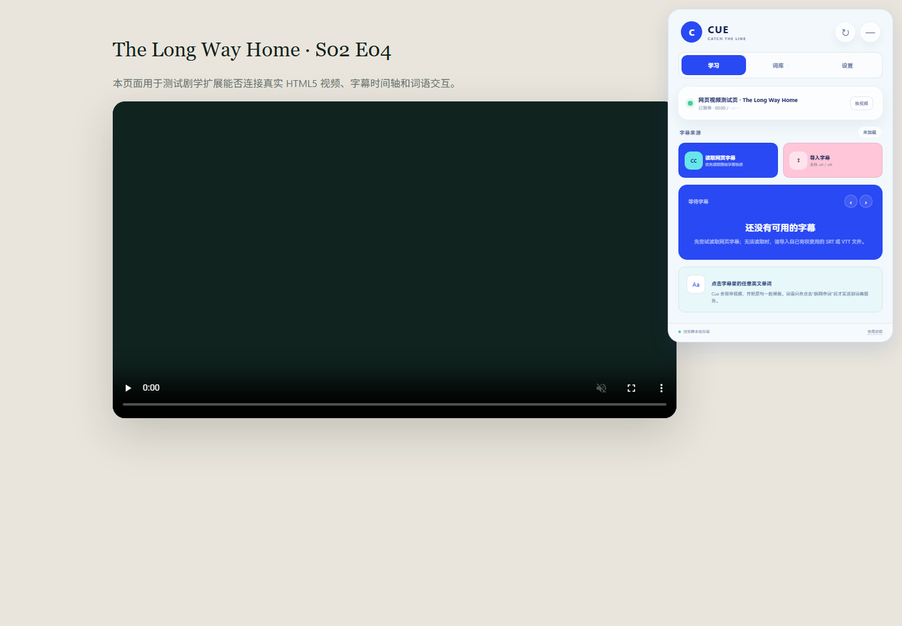

# Cue · 影视语言学习 MVP

这是根据 PRD 落地的可运行产品，包含两个部分：

- 根目录的 Web/PWA 演示版，用于体验完整学习流程。
- `extension/` 中的 Chrome / Edge 浏览器扩展，用于连接真实网页视频。

## 直接使用

最简单的打开方式：

1. 双击 `index.html`。
2. 按首次引导选择英语水平、学习目标和标注密度。
3. 在演示视频中播放或拖动进度，点击字幕里带下划线的内容。

体验完整 PWA（含离线缓存）时，在 PowerShell 打开本目录并执行：

```powershell
./start.ps1
```

然后访问 `http://localhost:4173`。关闭启动脚本所在窗口即可停止本地服务。

> 浏览器的语音合成能力用于单词发音。若系统没有安装英语语音包，发音按钮可能没有声音，但不影响其他功能。

## 分享给别人

这是一个纯静态 PWA，可以直接免费部署到 GitHub Pages。完整的仓库上传、发布和常见问题说明见 [DEPLOY.md](./DEPLOY.md)。

发布完成后，其他人通过 GitHub Pages 网址即可使用；收藏与笔记目前保存在每个用户自己的浏览器中。

## 真实网页视频扩展

`extension/` 是 Manifest V3 浏览器扩展，当前版本为 `0.3.2`，支持：

- 连接网页中的真实 HTML5 `<video>`，同步播放、暂停、拖动和倍速。
- 向同源 iframe 播放器注入学习面板。
- 读取网页 TextTrack、页面已渲染 CC 和公开 VTT/SRT 资源。
- 接入 Bilibili 视频信息与播放器字幕接口，优先选择英文轨道并对齐中文翻译。
- 通过页面桥接读取爱奇艺播放器字幕数据；平台没有文本轨道时会明确提示。
- 点击字幕中的英文单词，暂停视频并查看语境、释义和发音。
- 保存来源、原句、翻译和笔记到本地词库。



安装开发者版本：

1. 下载 [`downloads/cue-extension-0.3.2.zip`](./downloads/cue-extension-0.3.2.zip) 并解压，或者直接使用仓库中的 `extension/` 目录。
2. 打开 Chrome 的 `chrome://extensions`，或 Edge 的 `edge://extensions`。
3. 开启“开发者模式”，点击“加载已解压的扩展程序”。
4. 选择解压后的文件夹或仓库的 `extension/` 目录。
5. 打开网页视频，点击工具栏中的“Cue”，学习面板会直接叠加到当前页面。

详细安装、权限和技术边界见 [extension/README.md](./extension/README.md)。

## 已实现的范围

- 12 句同步演示字幕、播放/暂停、前后跳转、点击拖动时间轴、字幕显示切换和整集进度。
- 初级、中级、高级三种标注效果；精简、适中、丰富三种标注密度。
- 字幕内重点词汇与实用表达的双层标记，点击后自动暂停并显示语境卡。
- 单词/短语卡片包含音标、浏览器语音朗读、当前语境释义、常见释义、原句、使用场景和难度。
- 收藏、整句收藏、重复检测、标记已掌握和收藏后即时反馈。
- 完整个人词库：搜索、类型筛选、来源筛选、时间/字母排序、笔记、标签、发音、删除和 JSON 导出。
- 今日复习：先看原句回忆，再显示答案，并反馈“还不熟/记住了”。
- 偏好设置、首次引导、本地持久化、桌面与移动端响应式布局。
- 纯静态 PWA，可离线运行，收藏数据只保存在浏览器本地。

## 产品边界

当前版本使用一段原创矢量场景与预先校准的英文台词，明确验证产品交互，不声称已经具备以下能力：

- 抓取任意视频平台的受版权保护音视频或字幕。
- 对任意视频自动做语音识别并生成精准时间轴。
- 真实词典、大模型语境释义和真人发音服务。
- 云端账号、多设备同步、完整间隔重复算法和数据分析。

这些能力不应被伪造为已完成。下一阶段若继续工程化，建议按以下顺序推进：

1. 选定一个明确授权且可读取字幕的站点，完成浏览器扩展与网页播放器的同步。
2. 接入可合法处理音轨的 ASR 服务，并保留低置信度标识。
3. 将本地词库规则层替换为词典 + 上下文模型，增加释义缓存与成本控制。
4. 接入账号与加密同步，明确音视频数据不离开本地。
5. 基于复习数据实现真正的间隔重复。

## 文件说明

- `index.html`：应用结构、首次引导、观看页、词库、复习和设置。
- `styles.css`：视觉系统、播放器、响应式布局与动效。
- `app.js`：字幕、标注、查词、收藏、词库、复习和本地持久化逻辑。
- `assets/scene.svg`：离线电影剧照。
- `service-worker.js`：PWA 离线缓存。
- `extension/`：连接真实网页视频的 Chrome / Edge 扩展。
- `downloads/`：可直接分享的扩展安装包。

本地数据键为 `juxue.mvp.v1`。可在“学习偏好”底部重置演示数据。
